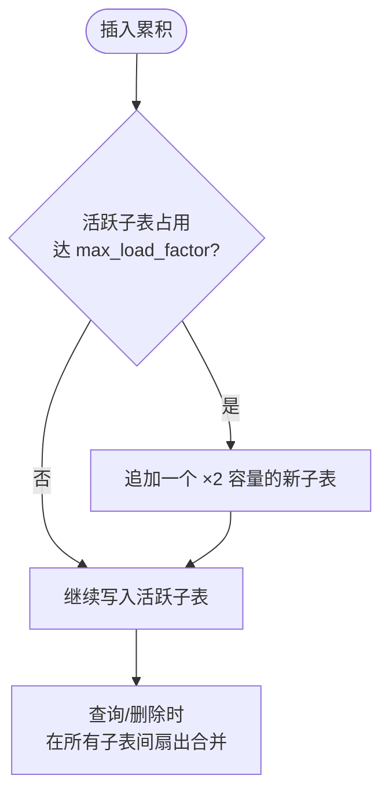
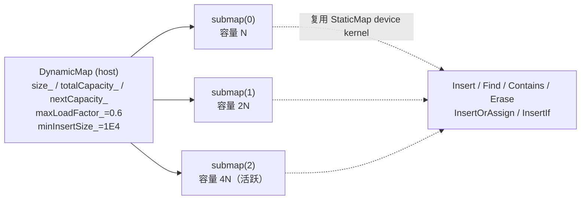
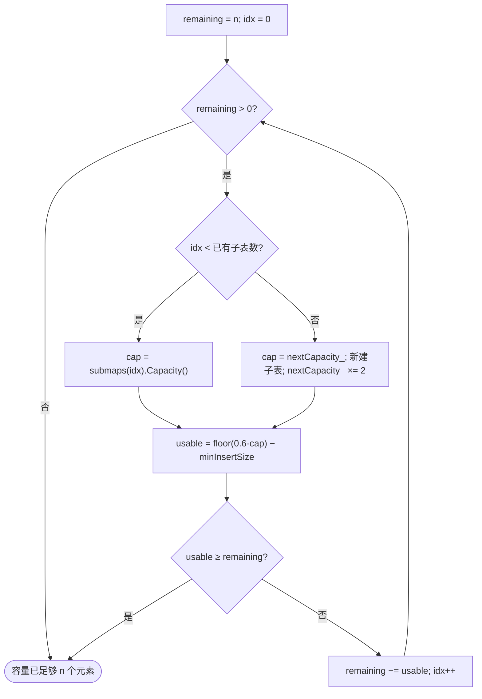
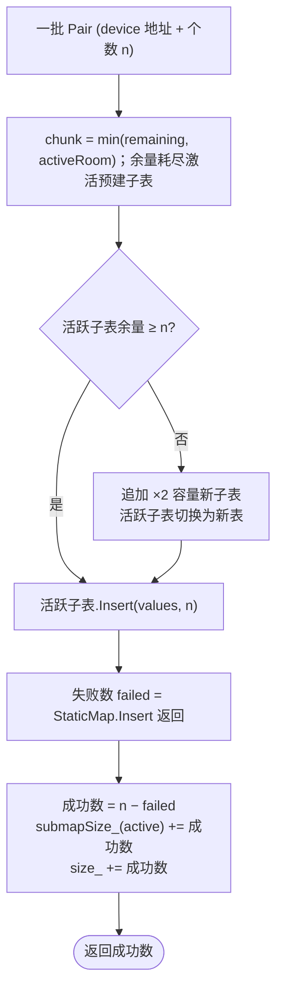
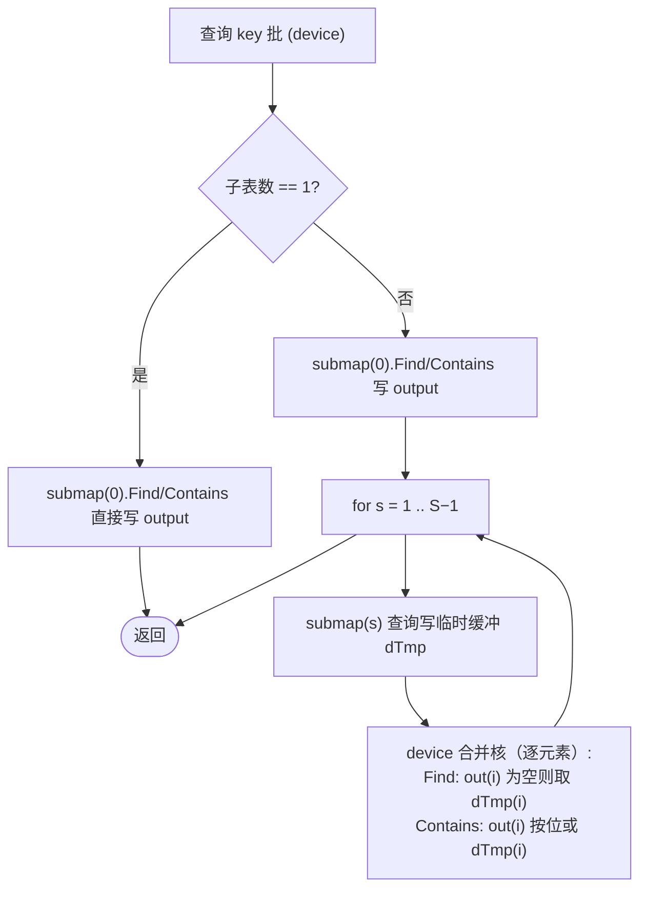
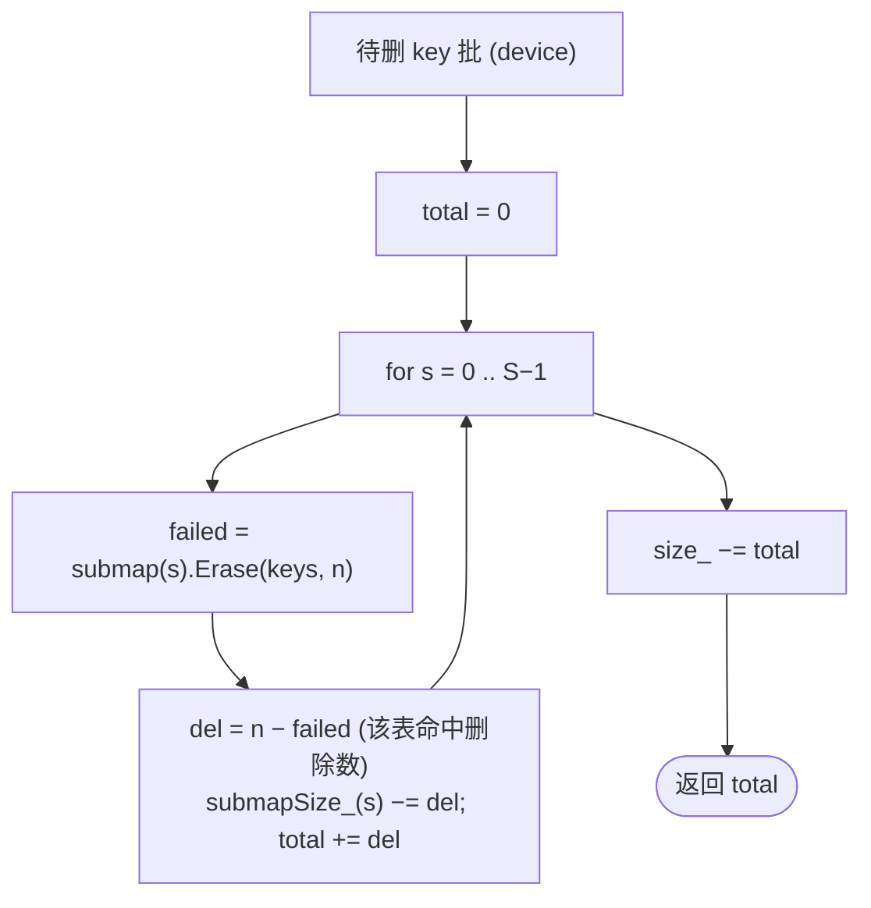

# DynamicMap 容器设计文档

## 一、需求背景

### 1.1 需求来源

社区任务 `dynamicMap_task_doc` 要求在昇腾 NPU 上基于 Ascend C / C++ 实现一个**可动态增长的并发哈希表容器**及其算子，完成容器及算子的设计、开发、测试全流程，验收通过后将代码提交至昇腾算子开源仓 [ops-collections](https://gitcode.com/cann/ops-collections)。

### 1.2 背景介绍

#### 1.2.1 容器目标

`dynamic_map` 是一个 `key → value` 的并发哈希表，容量随插入**自动增长**，对外提供以下接口：构造、析构、`Insert`、`Erase`、`Find`、`Contains`、`Reserve`、`InsertOrAssign`。`key` / `value` 数据类型支持 `uint16`、`uint32`、`uint64`、`float32`。

本次设计目标如下：

1. 提供上述 8 个接口与 4 种 key/value 类型，在合法输入下行为正确。
2. 接口以 `void* 起始地址 + 元素个数(Extent)` 替代 `first/last` 迭代器，语义保持一致，返回成功个数 `SizeType`。
3. 实现泛化功能，覆盖任意规模、`UNIQUE`/重复分布、各 `MatchingRate` 等合法输入场景。
4. 精度与 `tests/static_map` 参考实现一致；性能满足任务书规定的达标要求：以任务书性能用例的参考时延为基线，`I32`/`I16` 达标系数不低于 0.7、`I64` 不低于 0.5。
5. 适配硬件为 Ascend 950PR&950DT系列产品。

#### 1.2.2 基线来源说明

本任务以 ops-collections 已实现的 `StaticMap` 作为底层复用基线，功能与性能要求以社区任务 `dynamicMap_task_doc` 为准。设计分析参考路径如下：

| 基线层次 | 直接路径 | 作用 |
| --- | --- | --- |
| 底层哈希表复用层 | `include/static_map.h` / `include/detail/open_addressing/` | 复用开放寻址哈希表与全部 device kernel（Insert/Find/Contains/Erase 等） |
| 精度参考层 | `tests/static_map/*` | 核对各接口的功能场景与 golden 比对方式 |
| 性能要求层 | `dynamicMap_task_doc` 性能要求表 | 核对各接口的参考时延与达标系数 |

`DynamicMap` 与底层 `StaticMap` 的职责不同：`StaticMap` 负责单张定容开放寻址哈希表上的 device 计算；`DynamicMap` 负责 host 侧编排——管理一组会增长的 `StaticMap` 子表、跨子表的查询与删除合并以及 `size` 维护。设计文档按这两层分别描述。

#### 1.2.3 现状分析

ops-collections 仓**已实现 `StaticMap`**（开放寻址哈希表），公开接口含 `Insert` / `InsertOrAssign` / `InsertIf` / `InsertAndFind` / `Find` / `FindIf` / `Contains` / `ContainsIf` / `Erase` / `Clear` / `Count` / `Capacity`，构造形如 `StaticMap(capacity, emptyKey, emptyValue, pred, probingScheme, storage, stream)`，`key` / `value` 大小均不超过 8 字节，全部计算下沉至 AIV 核 device kernel（以 `<<<aivCoreNum, 0, stream>>>` 形式启动）。

由此，`DynamicMap` 的核心工作是在 `StaticMap` 之上的 **host 侧 C++ 编排层**：哈希表核心无需重新实现，只需新增"增长 + 跨子表合并 + size 维护"逻辑，以及一个用于多子表查询结果合并的轻量 device 合并核。本设计的关键常量为 `minInsertSize = 1E4`、`maxLoadFactor = 0.60`、增长因子 `2`。

动态增长哈希表的插入语义可抽象为三步：



## 二、需求分析

### 2.1 外部组件依赖

不引入新的第三方组件。复用 ops-collections 已有的 `StaticMap` 容器、`Pair` / `Extent` / `ProbingScheme` / `Storage` / 哈希器、测试公共件（`acl_env` / `device_buffer` / `generators` / `map_factory`）与性能测试框架（`tests/performance/performance_test_framework.h`）。

### 2.2 内部适配模块

| 模块 | 计划文件 | 设计职责 |
| --- | --- | --- |
| 容器头文件 | `include/dynamic_map.h` | `DynamicMap` 模板类：子表向量管理、增长、Insert/Find/Contains/Erase/Reserve/InsertOrAssign、size 维护 |
| 多子表合并核 | `include/dynamic_map.h`（内联 kernel） | `MergeFindSimt` / `MergeContainsSimt`：在 device 侧把各子表查询结果就地合并，免去 host 往返 |
| 功能测试 | `tests/dynamic_map/*.cpp` | 对照 `tests/static_map` 结构，覆盖构造/析构/Insert/Erase/Find/Contains/Reserve/InsertOrAssign 全场景 |
| 性能测试 | `tests/performance/dynamic_map/*.cpp` | 按任务书性能用例参数注册 perf 用例，输出 NPU 实测时延与达标系数 |
| 构建接入 | `tests/CMakeLists.txt` | 将 `dynamic_map/*.cpp` 纳入测试与性能 glob |

### 2.3 容器接口原型

#### 2.3.1 接口清单与复用映射（8 接口）

| 任务书接口 | DynamicMap 方法 | 复用的 StaticMap 原语 | 新增 host / device 逻辑 |
| --- | --- | --- | --- |
| 构造 | `DynamicMap(initCap, emptyKey, emptyValue, erasedKey, …, stream)` | StaticMap 构造 | 建首个子表、初始化 `size_` / `totalCapacity_` / `nextCapacity_` |
| 析构 | `~DynamicMap()` | StaticMap 析构（`unique_ptr` 自动） | 释放子表向量 |
| Reserve | `Reserve(n, stream)` | StaticMap 构造（按需新建子表） | 增长算法（×2） |
| Insert | `Insert(values, n, stream)` | `StaticMap.Insert`（表内去重） | 保证活跃子表余量；`成功数 = n − 失败数`；size 维护 |
| InsertOrAssign | `InsertOrAssign(values, n, stream)` | `StaticMap.InsertOrAssign` | 同上，仅新插入计入 size |
| Find | `Find(keys, out, n, stream)` | `StaticMap.Find` | 跨子表扇出 + device 合并核（取唯一命中） |
| Contains | `Contains(keys, out, n, stream)` | `StaticMap.Contains` | 跨子表扇出 + device 合并核（按位 OR） |
| Erase | `Erase(keys, n, stream)` | `StaticMap.Erase` | 对所有子表删除、累加删除数、size 维护 |

#### 2.3.2 接口入参说明

接口以 `void* 起始地址 + 元素个数(Extent)` 替代 first/last 迭代器，附加 `aclrtStream`。以 `Insert` 为例：

| 名称 | 类别 | dtype | 含义 |
| --- | --- | --- | --- |
| `values` | 输入 | `void*` | 被插入一批 `Pair<Key,Value>` 的 device 起始地址 |
| `valueNum` | 输入 | `Extent` | 需要插入的元素个数 |
| `stream` | 输入 | `aclrtStream` | 执行流 |
| 返回值 | 输出 | `SizeType` | 新插入成功的元素个数 |

#### 2.3.3 设计范围与约束

| 类别 | 约束项 | 约束内容 |
| --- | --- | --- |
| 功能 | 接口集 | 构造/析构/Insert/Erase/Find/Contains/Reserve/InsertOrAssign 共 8 个 |
| 适配硬件 | 产品 | Ascend 950PR&950DT系列产品 |
| dtype | key / value | `uint16`、`uint32`、`uint64`、`float32`（模板化） |
| 大小约束 | key / value | 各 ≤ 8 字节（继承 StaticMap 约束） |
| 增长 | 触发 | 活跃子表可用余量不足时追加 ×2 容量子表 |
| 常量 | 设计取值 | `minInsertSize = 1E4`、`maxLoadFactor = 0.60`、增长因子 `2` |
| 哨兵 | emptyKey/erasedKey/emptyValue | 不与有效 key 域冲突，`erasedKey ≠ emptyKey` |

## 三、需求详细设计

### 3.1 使能方式

本设计面向 C++ 容器直调场景，通过头文件 `include/dynamic_map.h` 引入，复用 ops-collections 的构建与测试工具链。

| 上层调用 | 状态 |
| --- | --- |
| C++ 容器直调（复用 StaticMap device kernel） | 支持 |

### 3.2 需求总体设计

`dynamic_map` 不在单表上 rehash，而是维护**一组 `StaticMap` 子表**（`vector<unique_ptr<StaticMap>>`）：插入量累积到占用阈值即新增一个 ×2 容量的子表，"活跃子表"恒为最后一个；查询/删除在所有子表间扇出后合并。容器整体架构如下：



数据结构定义：

```cpp
template <class Key, class T, class Extent, class KeyEqual, class ProbingScheme, class Storage>
class DynamicMap {
  std::vector<std::unique_ptr<StaticMap<Key,T,...>>> submaps_;  // 增长式子表
  std::vector<SizeType>                              submapSize_; // 各子表已用元素数
  SizeType size_;             // 当前元素总数
  SizeType totalCapacity_;    // 全部子表容量之和（Capacity() 返回值）
  SizeType nextCapacity_;     // 下一个子表的容量（每次 ×2）
  SizeType minInsertSize_;    // 子表可用余量阈值 = 1E4
  float    maxLoadFactor_;    // 最大负载因子 = 0.60
  Key emptyKey_; T emptyValue_; Key erasedKey_;
};
```

子表的"可用容量"定义为

`usable(cap) = floor(maxLoadFactor × cap) - minInsertSize`

以预留探测裕量、避免高负载下开放寻址探测链退化。

#### 设计要点：相对同类实现的优势

1. **全部计算在 NPU 上完成**：任意批量的 Insert / InsertOrAssign / Erase 都由 kernel 处理，host 只维护各子表元素计数等少量标量。不涉及 CPU 哈希索引与数据回拷，也不设小批量改走 CPU 的特殊路径，避免了双状态切换带来的边界问题。
2. **批次按余量分块**：活跃子表空间不足时，先用 `min(remaining, activeRoom)` 填满旧表，写满后再新建子表。旧子表空间得到充分利用，子表总数更少，查询和删除需要遍历的子表也更少。
3. **临时缓冲常驻**：跨子表合并、去重所需的 keys、mask、临时输出缓冲在首次使用时按峰值分配，其后一直复用直至析构，热路径上不再调用 aclrtMalloc/aclrtFree。
4. **单子表直通**：只有一个非空子表时直接调用 StaticMap 原接口，不引入任何额外 kernel。
5. **墓碑删除**：Erase 将命中槽置为 erasedKey 而非空键，确保探测链不断裂，未命中查询遇到真空槽即可提前结束；失败计数在寄存器累加、每线程只做一次全局原子加，大规模未命中场景实测提升约 268 倍。
6. **新子表后台预建**：活跃子表接近写满时通过后台流提前构造下一个子表，激活时只需等待一个事件，建表与清表的开销与插入流水重叠。

### 3.2.1 增长与写入设计（Reserve / Insert）

#### Reserve(n)

`Reserve` 保证总容量可容纳 `n` 个元素，增长策略：按子表逐个累加可用容量，不足则追加 ×2 容量的新子表：



#### Insert

`Insert` 按活跃子表余量分块写入（`min(remaining, activeRoom)`），块满激活预建子表；多子表时旧子表 `ContainsAsync` 生成 mask，`InsertIf` 仅写入 mask==0 的元素，返回**新插入个数**：



`InsertOrAssign` 流程一致，差别在于对已存在 key 执行 `StaticMap.InsertOrAssign` 更新 value，仅"新插入"计入 `size_`。

### 3.2.2 查询与合并设计（Find / Contains）

由于一个 key 至多落在一个子表，`Find`/`Contains` 需对所有子表查询后合并。单子表时直接转发 `StaticMap` 接口，没有额外开销；多子表时采用 **device 侧合并核**，把"逐子表写临时缓冲 → 取唯一命中 / 按位 OR"在 device 上就地完成，免去逐子表往返 host 的 D2H/H2D 拷贝，这是大规模场景下性能达标的关键：



device 合并核以 SIMT 方式启动（`<<<aivCoreNum, 0, stream>>>`），每线程处理一段下标，纯逐元素操作、无探测，开销远低于哈希查询本身，因此多子表查询的总时延约为"子表数 × 单表查询"。

### 3.2.3 删除设计（Erase）

key 至多存在于一个子表，`Erase` 对所有子表分别执行 `StaticMap.Erase`（device 原地删除，无 host 往返）。`StaticMap.Erase` 返回未删除（失败）数，故某子表实际删除数 `= n − failed`，累加得到总删除数，`size_ −= 总删除数`：



### 3.2.4 dtype 支持

`DynamicMap<Key,T>` 模板化，实例化 `uint16`/`uint32`/`uint64`/`float32` 的 key/value 组合；底层 `StaticMap` 已模板化，复用其哈希（`murmurhash3_32`）、比较器（`EqualTo`）与探测策略（`LinearProbing`）。device 合并核按 `value` 类型与哨兵 `emptyValue` 进行相等判断，`float` 按位/数值相等同样适用，不需要为类型单独特化。

### 3.2.5 性能优化策略

1. **单子表快路径**：`Find`/`Contains` 在仅一个子表时直接转发 `StaticMap`，不产生额外的拷贝与合并。
2. **device 侧合并**：多子表查询用 `MergeFindSimt`/`MergeContainsSimt` 在 device 就地合并，免去逐子表的 D2H/H2D 往返，是 8e7 规模下满足任务书性能要求的关键。
3. **增长因子 2**：子表数为 `O(log n)`，查询扇出次数受控；`Find`/`Contains`/`Erase` 时延 ∝ 子表数。
4. **写入仅触及活跃子表**：`Insert` 仅对最后一个子表做一次 `StaticMap.Insert`，与单表插入同阶，无多表写放大。
5. **size 在 host 维护**：`size_` / `submapSize_` 全程在 host 计数，`Size()` 查询不产生任何 device 开销。
6. **复用 StaticMap 核**：哈希探测、插入、删除全部走已优化的 AIV device kernel，DynamicMap 不引入额外探测开销。

下面三点是 DynamicMap 复用的**底层并发哈希核**针对昇腾硬件做的原子层优化（决定 Insert/InsertOrAssign 的吞吐上限）：

1. **单原子最小化（PackCas）**：当 key 与 value 合计可放入单个 ≤8 字节的机器字时（如 `u16`/`u32` key + ≤4B value），把 `(key, value)` 打包进一个机器字，用**一次** `AtomicCAS` 同时完成"槽位归属仲裁 + value 写入"。开放寻址哈希每个 key 必须在目标槽上做一次原子仲裁，本路径把每 key 的原子操作压到理论下界 **1 次/key**。
2. **>8 字节的依赖写（CasDependentWrite）**：当 key/value 超 8B（如 `u64` value）无法单原子打包时，采用 **1 次 `AtomicCAS` 占据 key 槽 + 1 次普通 store 写 value** 的"依赖写"，替代连续两次原子 CAS（`BackToBackCas`）。Find 侧以 `WaitForPayload` 等待 value 落盘后再读，既保证可见性、又把每 key 原子操作维持在 1 次。该优化是 `I64@160M` 由 41.28ms 降至 39.19ms 的关键。
3. **异步批量插入（InsertAsync）**：8e7 规模按 `BatchSize=800k` 切批，各批在同一 `stream` 上 `InsertAsync` 连续下发、**批间不 Sync**，借助 device 流水重叠，仅在末批后一次同步取结果，消除逐批 host 往返带来的气泡。

### 3.2.6 类型相关的特殊情况与边界处理

并发哈希在不同 dtype / 边界输入下需差异化处理，以下为实现中显式覆盖的特殊情况（其中类型相关项由 DynamicMap 复用的共享内核保证，已随 `third_party/ops-collections` 内置）：

| 特殊情况 | 处理方式 |
| --- | --- |
| **窄 key（`uint16`，<4B）的 InsertOrAssign** | 硬件不支持 16 位原子 CAS。以 `if constexpr (sizeof(Key) < 4 && sizeof(Value) ≤ 8)` 采用打包路径：把 `(key,value)` 合并为 ≤8B 字执行单次 PackCas；遇 `DUPLICATE`（key 已存在）则改写 value，实现 assign 语义。 |
| **`>8B` value（`uint64`）的 Insert/Find** | 见 3.2.5 第 2 点 CasDependentWrite；Find 命中后 `WaitForPayload` 确保读到已写入的 value，避免读到"已占槽但 value 未落盘"的中间态。 |
| **删除与墓碑（erasedKey）** | `Erase` 将命中槽置为 `erasedKey`（而非 `emptyKey`），确保开放寻址探测链不被截断、且被删槽位可被后续插入复用；要求 `erasedKey ≠ emptyKey` 且不与有效域冲突。 |
| **`n == 0` 空输入** | 所有接口对 0 元素快速返回（不启 device kernel），`size_` 不变，返回 0。 |
| **同批/跨批重复 key** | 由活跃子表内 CAS 同槽仲裁去重——同一 key 仅一个写入者占据槽位，`Insert` 返回值为去重后的实际新增数；`size_` 据此累加，不会重复计数。 |
| **插入中途触发增长** | 同步 Insert 按余量分块，块满才激活新子表，块内不增长；异步 InsertAsync 写前 `EnsureActiveRoom(n)` 保证整批落在同一子表内。 |
| **跨子表 InsertOrAssign 重新赋值** | 对"已存在于非活跃子表"的 key 重新赋值，当前仅写入活跃子表会产生重复（见 §5 已知限制）；对增长容器**插入全新键**（常规用法）完全正确。 |
| **`float` value 的命中判断** | 合并核以 `value == emptyValue` 判定是否命中，`float` 按数值与按位相等处理，与整型走同一套逻辑，无需特化。 |

### 3.3 支持硬件

| 支持的芯片版本 | 涉及勾选 |
| --- | --- |
| Ascend 950PR&950DT系列产品 | √ |

### 3.4 算子约束限制

1. 支持 `uint16`、`uint32`、`uint64`、`float32` 的 key/value 类型，key 与 value 大小均不超过 8 字节。
2. 接口以 `void* + Extent` 表达 device 数据，附 `aclrtStream`。
3. 哨兵 `emptyKey` / `erasedKey` / `emptyValue` 不得与有效数据域冲突，且 `erasedKey ≠ emptyKey`。
4. 增长常量：`minInsertSize = 1E4`、`maxLoadFactor = 0.60`、增长因子 `2`。
5. `Insert` 返回新插入成功个数；重复 key 由底层 `StaticMap` 表内去重保证唯一性。

## 四、特性交叉分析

| 交叉维度 | 设计关注点 | 应对策略 |
| --- | --- | --- |
| 规模 × 子表数 | 大插入量触发多次增长，子表数增加 | 增长因子 2 使子表数 `O(log n)`，查询扇出可控 |
| 单子表 vs 多子表 | 查询路径不同，性能差异大 | 单子表直接转发；多子表走 device 合并核 |
| dtype（含 float32） | value 相等判断与哨兵比较 | 合并核按 value 类型与 `emptyValue` 比较，float 一致处理 |
| MatchingRate（Find/Contains/Erase） | 命中率影响有效工作量 | 语义与命中率无关；扇出按子表数恒定，结果正确性不受影响 |
| Insert 重复 key | 同批/跨批重复 key | 活跃子表内由 StaticMap 表内去重；UNIQUE 分布下完全正确 |
| InsertOrAssign 已存在 key | 更新 value 但不增 size | 仅"新插入"计入 `size_`，更新不计 |
| Reserve 与 Insert 协同 | 预留容量后插入应零再增长 | Reserve 与 EnsureActiveRoom 共用同一增长算法，阈值一致 |
| 空容器 / 满载 / 全重复 / 全唯一 | 边界行为 | 子表数为 0/1/多、命中为 0/全的各种组合均有用例覆盖 |
| size 维护 | 多子表下计数一致性 | `submapSize_` 分表计数 + `size_` 汇总，Insert/Erase/Clear 同步更新 |

## 五、可维可测分析

### 5.1 验收标准与验证方式

| 验收项 | 标准 | 说明 |
| --- | --- | --- |
| 功能标准 | 接口行为正确 | 8 个接口在合法输入下行为正确 |
| 精度标准 | 与 golden 逐元素一致 | 以 host 侧 `std::unordered_map` 作为 golden，比对 Find/Contains/Erase/size |
| 性能标准 | I32/I16 达标系数 ≥ 0.7，I64 ≥ 0.5 | 以任务书性能用例的参考时延为基线，输出 NPU 实测时延与达标系数表 |
| 泛化标准 | 覆盖合法泛化输入 | dtype、规模、分布、MatchingRate、增长触发 |
| 可复现 | 自验证报告含日志/截图 | 测试用例执行日志、整体通过截图、性能数据截图 |

### 5.2 验证矩阵

| 验证项 | 典型场景 | 验证方式 / 产出 |
| --- | --- | --- |
| dtype 覆盖 | `uint16`/`uint32`/`uint64`/`float32` 的 key/value | 模板化测试用例交叉 |
| 接口覆盖 | 构造/析构/Insert/Erase/Find/Contains/Reserve/InsertOrAssign | 对照 `tests/static_map` 同构补齐 |
| 增长覆盖 | 小 initCap + 大插入量，强制多子表 | 断言 `NumSubmaps() > 1` 且功能正确 |
| MatchingRate | Find/Contains/Erase 在 0.1 / 0.5 / 1.0 | 校验命中/未命中与删除计数 |
| 边界场景 | 空容器查询、满载、全重复、全唯一、单元素 | 校验返回与 size |
| golden 比对 | 全部功能场景 | `std::unordered_map` 逐元素比对 |
| 性能场景 | 80000000 插入、InitSize 40M/160M、BatchSize 800000 | 输出 NPU 实测时延与达标系数表 |

### 5.3 兼容性分析

本设计在 `StaticMap` 之上以纯 host 编排 + 轻量 device 合并核实现 `DynamicMap`，不修改 `StaticMap` 既有接口与行为，对仓内其它容器无侵入。key/value 类型与大小约束继承自 `StaticMap`。任务书范围外的 dtype、超长 key/value 由底层 `StaticMap` 的 `static_assert` 与类型系统在编译期拒绝。

### 5.4 待评审通过后进入开发/验收的交付件

1. `DynamicMap` 容器代码（`include/dynamic_map.h`）+ 多组功能测试（`tests/dynamic_map/`）+ 性能测试（`tests/performance/dynamic_map/`），提交 ops-collections fork。
2. 自验证报告（全功能场景 + 性能达标数据，参考 static_set 容器自验证报告格式）。
3. README 文档。
